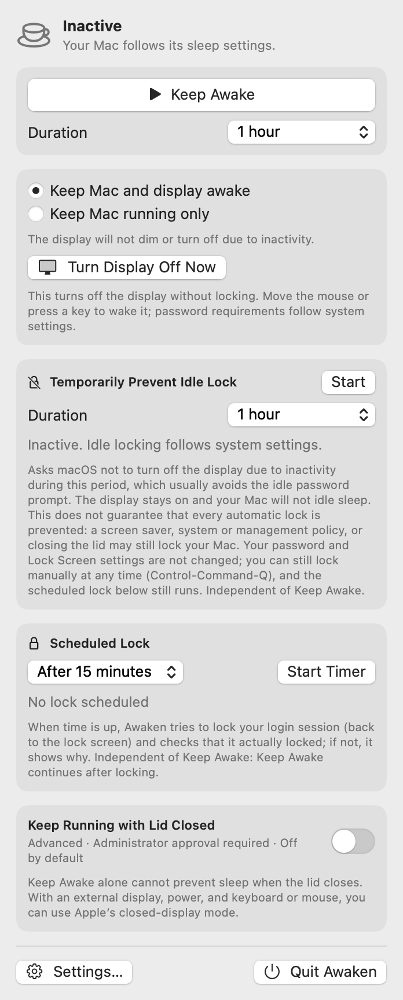

# Awaken 靜醒


Awaken is a macOS menu bar app for controlling idle sleep and lock timing. It supports English and Traditional Chinese and works without an internet connection.

[繁體中文](README.md) · [Features](#features) · [View interface](#interface-preview) · [Download and install](#download-and-install) · [How to use](#how-to-use) · [Donation](#donation)

**Requirements:** A Mac with Apple Silicon (M-series chip) and macOS 14 or later. Intel Macs are not supported.

## Features

- **Keep awake:** Choose a duration and keep both your Mac and display awake, or keep only the Mac running.
- **Temporarily prevent idle lock:** Keep the display on during inactivity to reduce idle password prompts. Other conditions may still lock your Mac.
- **Scheduled lock:** Set a timer that tries to lock your Mac when it expires, independently of Keep Awake.
- **Language and permission settings:** Choose English or Traditional Chinese and review Accessibility and administrator authorization information.
- **Keep running with the lid closed:** An advanced option, off by default, that requires administrator authorization. Read the [limitations](#how-to-use) first.

## Interface preview

[](Assets/screenshots/main-en.png)

The menu bar panel. Click the image to enlarge it.

## Download and install

1. On your Mac, open the [Awaken v0.1.0 release page](https://github.com/LeoFeng0816/Awaken/releases/tag/v0.1.0). Under **Assets**, click **Awaken-v0.1.0-macOS-arm64.dmg**. You can also [download the installer directly](https://github.com/LeoFeng0816/Awaken/releases/download/v0.1.0/Awaken-v0.1.0-macOS-arm64.dmg).
2. When the download finishes, find the `.dmg` file in Finder's Downloads folder and double-click it.
3. In the window that opens, drag **Awaken** onto the **Applications** folder icon and wait for the copy to finish.
4. Open the Applications folder in Finder and double-click **Awaken**. If macOS displays a warning and blocks it, follow the [steps below](#if-macos-blocks-the-first-launch).
5. Click the **coffee cup icon** in the menu bar at the top of the screen to use Awaken. It does not appear in the Dock. Once installed, you can eject the Awaken disk image from the Finder sidebar.

### If macOS blocks the first launch

The v0.1.0 app has an ad-hoc signature; it is **not signed with an Apple Developer ID or notarized by Apple**. macOS may therefore block its first launch. First confirm that the file came from this project's [GitHub release](https://github.com/LeoFeng0816/Awaken/releases/tag/v0.1.0), and continue only if you trust the app and its source:

1. As above, try to open Awaken from the **Applications** folder in Finder. Dismiss the warning with Done or OK.
2. Click the **Apple menu → System Settings** in the top-left corner of your screen, then select **Privacy & Security**.
3. Scroll down to **Security** and click **Open Anyway** beside the message about Awaken. If it is not there, try opening Awaken from Applications again; the button is available for about an hour after the attempt.
4. Follow the prompts to choose Open and confirm with your Mac login password or Touch ID. Then click the coffee cup icon in the menu bar to open the panel.

Wording can vary by macOS version. See [Apple's guide to opening apps safely](https://support.apple.com/en-us/102445). Do not proceed if macOS warns that the app contains malware or that the file is damaged.

<details>
<summary>Optional: check the downloaded file's integrity</summary>

Download `Awaken-v0.1.0-macOS-arm64.dmg.sha256` from the release page as well. Put it and the DMG in Downloads, open Terminal, and run:

```bash
cd ~/Downloads && shasum -a 256 -c Awaken-v0.1.0-macOS-arm64.dmg.sha256
```

`OK` means the DMG matches the downloaded checksum. A checksum helps detect changes to the file, but does not by itself establish that the source is trustworthy.

</details>

## How to use

1. Click the coffee cup icon in the menu bar, choose a **mode** and **duration**, and click **Keep Awake**. Click **Stop Keeping Awake** when finished. The app does not activate this feature automatically on launch.
2. To reduce idle locking temporarily, use **Temporarily Prevent Idle Lock** and choose a duration. This asks macOS to keep the display on; it **does not guarantee that the Mac will never lock**. A screen saver, system or management policy, or closing the lid can still cause a lock.
3. To schedule a lock, choose a time under **Scheduled Lock** and start the timer. You can cancel it at any time. Scheduled locking has not been fully verified on real hardware and may depend on system version, permissions, and settings; the app reports a failure if it cannot lock.
4. Open **Settings…** in the panel to choose a language, check permission status, and open the relevant system settings. Quit and reopen Awaken after changing the language. The alternative method for scheduled locking may require Accessibility permission.
5. Click **Quit Awaken** to close the app. Keep Awake alone does not guarantee that the Mac stays awake with its lid closed.

**Lid-closed mode limitations:** “Keep Running with Lid Closed” is an advanced option that is off by default. It temporarily disables **system-wide sleep**, requires administrator authorization, and has not been fully verified with real administrator rights and lid closure. Keep the Mac ventilated and powered, and never place it in a bag while running. An unexpected shutdown may require restoring system settings; read the [advanced use and recovery guide](docs/technical.en.md) before using it.

If you cannot find the coffee cup icon, check whether a display notch or a menu bar organizer is hiding it. For more instructions, known limitations, recovery steps, and developer build information, see [advanced use and technical details](docs/technical.en.md).

## License

The project code and app icon are licensed under the [MIT License](LICENSE). Apple system icons in the interface and other macOS resources remain subject to Apple's terms.

## Donation

If you enjoy Awaken, you can support the project. Thank you!

[](https://www.paypal.com/ncp/payment/UY8JAHZCRVDLY)

**Cryptocurrency**

- Stablecoins (USDT, USDC, PYUSD; Solana network): `BCyMirZrcGhcKUonkhykfnUq5pQbeUbXgCQmwJQfjy1o`
- Solana (Solana network): `BnE2VfdgKE2aubg9YpJuPSTFpFgbMawaqcbxXJkff2kL`
- Ethereum (Ethereum network): `0xa8d689b94a54414362b2bd0e6f0cb2a74651f4b0`
- Bitcoin (BTC Taproot): `bc1panr25wetvhl2kyxquu3re6ts4pw6g7fwdul8hpv4shaqu7g9qhyq68twql`
