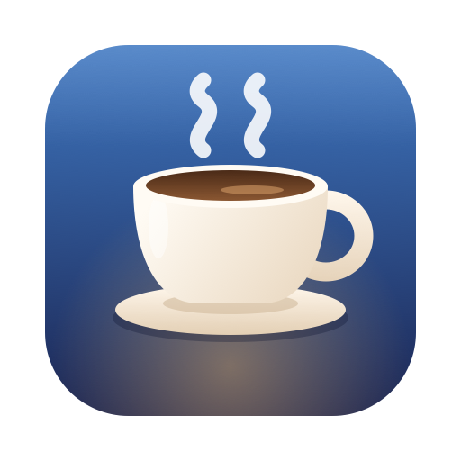
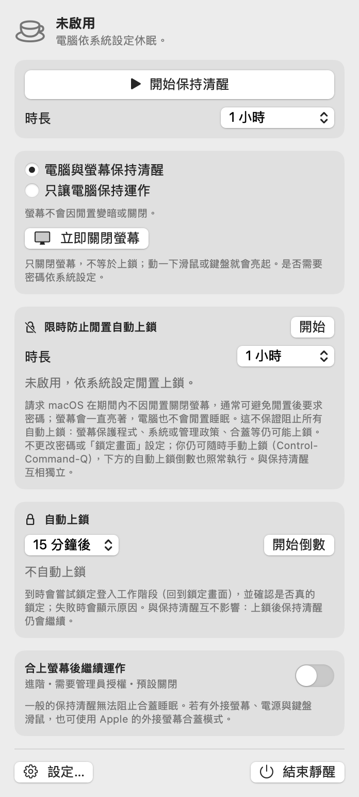

# 靜醒 Awaken



靜醒是一款 macOS 選單列工具，讓你依照需要控制 Mac 的閒置睡眠與上鎖時間。支援繁體中文和英文，無須網路連線。

[English](README.en.md) · [功能](#功能) · [查看介面](#介面預覽) · [下載與安裝](#下載與安裝) · [使用方式](#使用方式) · [捐款](#捐款-donation)

**系統需求：**搭載 Apple Silicon（M 系列晶片）的 Mac，macOS 14 或以上；不支援 Intel Mac。

## 功能

- **保持清醒**：選擇時長，讓 Mac 與螢幕保持清醒，或只讓 Mac 保持運作。
- **限時防止閒置自動上鎖**：讓螢幕暫時不因閒置而關閉，減少閒置後要求密碼的情況。其他原因仍可能造成上鎖。
- **自動上鎖倒數**：設定時間，時間到時嘗試鎖定 Mac；這與保持清醒互不影響。
- **語言與權限設定**：切換繁體中文或英文，並查看輔助使用和管理員授權的說明。
- **合蓋後繼續運作**：進階選項，預設關閉，需要管理員授權；請先閱讀下方的[使用限制](#使用方式)。

## 介面預覽

[](Assets/screenshots/main-zh-Hant.png)

靜醒的選單列面板；點擊圖片可放大。

## 下載與安裝

1. 在 Mac 上開啟 [Awaken v0.1.0 下載頁面](https://github.com/LeoFeng0816/Awaken/releases/tag/v0.1.0)。在頁面的 **Assets** 下方，點選 **Awaken-v0.1.0-macOS-arm64.dmg**；也可以[直接下載安裝檔](https://github.com/LeoFeng0816/Awaken/releases/download/v0.1.0/Awaken-v0.1.0-macOS-arm64.dmg)。
2. 下載完成後，在 Finder 的「下載項目」中找到並連按兩下該 `.dmg` 檔案。
3. 在開啟的視窗中，將 **靜醒** 圖示拖到 **Applications（應用程式）** 資料夾圖示上，等待複製完成。
4. 打開 Finder 的「應用程式」資料夾，連按兩下 **靜醒** 開啟。若 macOS 顯示無法開啟的警告，請依照[下方步驟](#如果-macos-阻擋首次開啟)操作。
5. 開啟後，點選螢幕最上方選單列的**咖啡杯圖示**，就能使用靜醒。它不會顯示在 Dock 中。完成安裝後，可在 Finder 側邊欄退出 Awaken 磁碟映像檔。

### 如果 macOS 阻擋首次開啟

v0.1.0 的 App 使用 ad-hoc 簽章，**沒有 Apple Developer ID 簽章，也未經 Apple 公證**，因此 macOS 可能阻擋首次開啟。請先確認檔案來自本專案的 [GitHub Release](https://github.com/LeoFeng0816/Awaken/releases/tag/v0.1.0)，並且只在信任這個 App 和來源時繼續：

1. 如上所述，先從 Finder 的「**應用程式**」資料夾嘗試開啟靜醒。看到警告後，按「完成」或「好」關閉提示。
2. 點選螢幕左上角的 **Apple 選單  →  系統設定**，再選擇「**隱私權與安全性**」。
3. 向下捲動至「**安全性**」，在關於靜醒的提示旁點選「**仍要打開**」。若沒有看到，請回到「應用程式」再嘗試開啟一次；按鈕會在嘗試開啟後約一小時內出現。
4. 依畫面指示選擇「打開」，並使用 Mac 登入密碼或 Touch ID 確認。完成後，再從選單列的咖啡杯圖示開啟面板。

選項名稱可能隨 macOS 版本略有不同。詳見 [Apple：安全地開啟 Mac 上的 App](https://support.apple.com/zh-tw/102445)。若出現惡意軟體或檔案已損毀的警告，請勿繼續開啟。

<details>
<summary>選用：檢查下載檔案是否完整</summary>

在 Release 頁面同時下載 `Awaken-v0.1.0-macOS-arm64.dmg.sha256`，將它和 DMG 放在「下載項目」，打開「終端機」並執行：

```bash
cd ~/Downloads && shasum -a 256 -c Awaken-v0.1.0-macOS-arm64.dmg.sha256
```

顯示 `OK` 代表 DMG 與下載的校驗值相符。校驗值可協助檢查檔案是否改變，但不能單獨證明來源可信。

</details>

## 使用方式

1. 點選選單列的咖啡杯圖示，選擇保持清醒的**模式**和**時長**，再按「**開始保持清醒**」。需要時可按「停止保持清醒」。程式開啟時預設不會自動啟用。
2. 如需暫時減少閒置後上鎖，使用「**限時防止閒置自動上鎖**」並選擇時長。此功能請求 macOS 保持螢幕開啟，**不能保證完全防止上鎖**：螢幕保護程式、系統或管理政策、合蓋等情況仍可能上鎖。
3. 如需定時上鎖，在「**自動上鎖**」區選擇時間並開始倒數；可隨時取消。自動上鎖尚未完整實機驗證，可能受系統版本、權限或設定影響；如果上鎖失敗，App 會顯示原因。
4. 點選面板中的「**設定…**」可選擇語言、查看權限狀態及開啟相關系統設定。變更語言後，請結束並重新開啟靜醒。自動上鎖在使用替代鎖定方式時可能需要「輔助使用」權限。
5. 點選「**結束靜醒**」可關閉程式。一般保持清醒功能無法保證 Mac 合蓋後繼續運作。

**合蓋模式的限制：**「合上螢幕後繼續運作」是預設關閉的進階功能，會暫時停用**全系統睡眠**、需要管理員授權，而且尚未以實際管理員權限和合蓋操作完整驗證。使用時請保持通風與供電，切勿將運作中的 Mac 放進包包。異常關閉後可能需要還原系統設定；使用前請閱讀[進階操作與復原說明](docs/technical.zh-Hant.md)。

若找不到咖啡杯圖示，請檢查選單列是否被瀏海或選單列收納工具遮住。更多操作、已知限制、故障復原和開發者建置方式，請參閱[進階操作與技術資訊](docs/technical.zh-Hant.md)。

## 授權

本專案程式碼與 App 圖示依 [MIT License](LICENSE) 授權。介面中的 Apple 系統圖示與 macOS 系統資源仍依 Apple 各自的條款使用。

## 捐款 Donation

如果你喜歡靜醒，歡迎支持這個專案。感謝你的支持！

[](https://www.paypal.com/ncp/payment/UY8JAHZCRVDLY)

**加密貨幣**

- 穩定幣（USDT、USDC、PYUSD；Solana 網路）：`BCyMirZrcGhcKUonkhykfnUq5pQbeUbXgCQmwJQfjy1o`
- Solana（Solana 網路）：`BnE2VfdgKE2aubg9YpJuPSTFpFgbMawaqcbxXJkff2kL`
- Ethereum（Ethereum 網路）：`0xa8d689b94a54414362b2bd0e6f0cb2a74651f4b0`
- Bitcoin（BTC Taproot）：`bc1panr25wetvhl2kyxquu3re6ts4pw6g7fwdul8hpv4shaqu7g9qhyq68twql`
